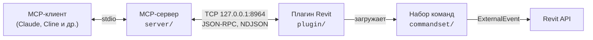

# MCPServersRevit

**Подключение ИИ-ассистентов к Autodesk Revit через Model Context Protocol.**

Форк проекта [mcp-servers-for-revit](https://github.com/mcp-servers-for-revit/mcp-servers-for-revit), доработанный по итогам аудита стабильности, скорости и качества результатов.
MCP-клиенты (Claude, Cline и другие) могут читать, создавать, изменять и удалять элементы модели Revit и выполнять в Revit произвольный C#.

## Чем отличается от исходного проекта

- **Стабильное соединение.** Плагин слушает только `127.0.0.1:8964`: порт меняется в настройках, сеть недоступна. Сообщения разделяются по строкам (NDJSON), поэтому ограничение в 8 КБ на запрос снято. Сервер держит одно постоянное соединение с переподключением и сразу сообщает об обрыве, а не ждёт 2 минуты.
- **Revit не зависает.** Устранена гонка, из-за которой готовый результат терялся и выдавался ложный таймаут. Ошибки команд возвращаются клиенту, а не показываются модальными окнами. Предупреждения Revit во время MCP-запросов не открывают диалоги и возвращаются в ответе (`revitWarnings`). Команды выполняются строго по одной, а повторный запрос во время зависшего предыдущего отклоняется с понятной ошибкой.
- **Работает в русском Revit.** Параметры читаются через `BuiltInParameter`, а не по английским именам. Координаты и длины отдаются в миллиметрах.
- **Быстрый и понятный `send_code_to_revit`.** Компиляция кэшируется. Ошибки компиляции и выполнения указывают строку вашего кода, исходное исключение не теряется, неудачи возвращаются как ошибки.
- **Честные ошибки для ИИ.** Неудачные вызовы помечаются `isError`, ответы отдаются компактным JSON.
- **Тесты и CI.** Тесты транспорта и MCP по stdio без Revit, сборка Revit 2024–2026 на каждый PR.

Подробности:
- [docs/AUDIT.md](docs/AUDIT.md) — найденные проблемы и их статус;
- [docs/CHANGELOG-stability.md](docs/CHANGELOG-stability.md) — что изменено на каждом этапе.

> [!IMPORTANT]
> Порт по умолчанию изменён с 8080 на 8964. Сервер и плагин этого форка нужно обновлять вместе. Пакет `mcp-server-for-revit` из npm и релизы исходного проекта используют старый протокол и порт 8080.

## Архитектура



- **MCP-сервер** (TypeScript) превращает вызовы инструментов в JSON-RPC запросы.
- **Плагин Revit** (C#) принимает запросы и по одному передаёт их **набору команд** (C#).
- Набор команд выполняет операции через Revit API в потоке Revit и возвращает результат.

## Требования

- Node.js 20+
- Autodesk Revit 2020–2026
- .NET 8 SDK для сборки плагина

## Установка из исходников

### 1. Плагин и набор команд

```powershell
dotnet build mcp-servers-for-revit.sln -c "Release R25"   # R20…R26 — год Revit
```

Сборка собирает готовую раскладку в `plugin\bin\AddIn <год> Release R25\`.
Скопируйте её содержимое (`mcp-servers-for-revit.addin` и папку `revit_mcp_plugin\`) в `%AppData%\Autodesk\Revit\Addins\<год>\`.
Конфигурации `Debug R2x` копируют файлы в эту папку автоматически.

В Revit: вкладка **Add-Ins → Revit MCP Switch** включает сервис. В диалоге будет показан адрес, например `127.0.0.1:8964`.

- Revit 2020–2024: .NET Framework 4.8.
- Revit 2025–2026: .NET 8.

### 2. MCP-сервер

```powershell
cd server
npm install
npm run build
```

Claude Code:

```powershell
claude mcp add revit -- node D:\path\to\MCPServersRevit\server\build\index.js
```

Claude Desktop (`claude_desktop_config.json`):

```json
{
  "mcpServers": {
    "revit": {
      "command": "node",
      "args": ["D:\\path\\to\\MCPServersRevit\\server\\build\\index.js"],
      "env": { "REVIT_MCP_PORT": "8964" }
    }
  }
}
```

### Настройки подключения

Порт плагина задаётся в `%AppData%\Autodesk\Revit\Addins\<год>\revit_mcp_plugin\Commands\commandRegistry.json`:

```json
{ "settings": { "port": 8964, "logLevel": "Info" } }
```

Переменные окружения MCP-сервера:

| Переменная | По умолчанию | Назначение |
|-----------|--------------|------------|
| `REVIT_MCP_PORT` | `8964` | порт плагина |
| `REVIT_MCP_HOST` | `127.0.0.1` | адрес плагина |
| `REVIT_MCP_TIMEOUT_MS` | `150000` | ожидание результата команды |
| `REVIT_MCP_CONNECT_TIMEOUT_MS` | `5000` | ожидание подключения к Revit |
| `REVIT_MCP_DB` | `%APPDATA%\mcp-server-for-revit\revit-data.db` | файл SQLite для `store_*` / `query_*` |

Журнал плагина пишется в `revit_mcp_plugin\Logs\mcp_<дата>.log`.

## Инструменты

| Инструмент | Назначение |
| ---------- | ---------- |
| `get_current_view_info` | сведения об активном виде |
| `get_current_view_elements` | элементы активного вида (координаты в мм) |
| `get_available_family_types` | доступные типоразмеры семейств |
| `get_selected_elements` | выбранные элементы |
| `get_material_quantities` | ведомость материалов |
| `ai_element_filter` | гибкий поиск элементов |
| `analyze_model_statistics` | статистика модели |
| `create_point_based_element` | элементы по точке (двери, окна, мебель) |
| `create_line_based_element` | элементы по линии (стены, балки, трубы) |
| `create_surface_based_element` | элементы по контуру (перекрытия, потолки, крыши) |
| `create_grid` | сетка осей |
| `create_level` | уровни |
| `create_room` | помещения |
| `create_dimensions` | размеры на активном виде |
| `create_structural_framing_system` | система балок |
| `delete_element` | удаление элементов по id |
| `operate_element` | выделение, цвет, скрытие и другие операции |
| `color_elements` | раскраска по значению параметра |
| `tag_all_walls` | марки всех стен на виде |
| `tag_all_rooms` | марки всех помещений на виде |
| `export_room_data` | выгрузка данных помещений |
| `store_project_data` / `store_room_data` / `query_stored_data` | локальная база данных проекта |
| `send_code_to_revit` | выполнение C# в Revit |
| `say_hello` | проверка связи |

## Разработка и тесты

```powershell
cd server
npm test   # транспорт и MCP по stdio против фейкового плагина, Revit не нужен
```

Интеграционные тесты команд в `tests/commandset` (TUnit) запускаются против запущенного Revit 2025/2026:

```powershell
dotnet test -c Debug.R26 -r win-x64 tests/commandset
```

CI (`.github/workflows/ci.yml`) на каждый PR собирает и тестирует сервер и собирает решение для Revit 2024, 2025 и 2026.

## Структура

```
├── mcp-servers-for-revit.sln   # решение: плагин + команды + тесты
├── command.json                # манифест набора команд
├── server/                     # MCP-сервер (TypeScript)
├── plugin/                     # плагин Revit (C#), TCP-мост
├── commandset/                 # реализация команд (C#)
├── tests/                      # интеграционные тесты (C#)
└── docs/                       # аудит и журнал изменений
```

## Лицензия

[MIT](LICENSE).
